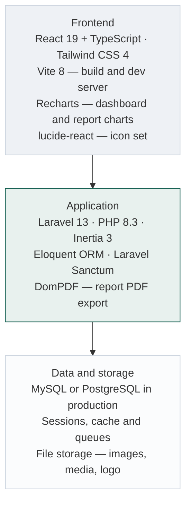
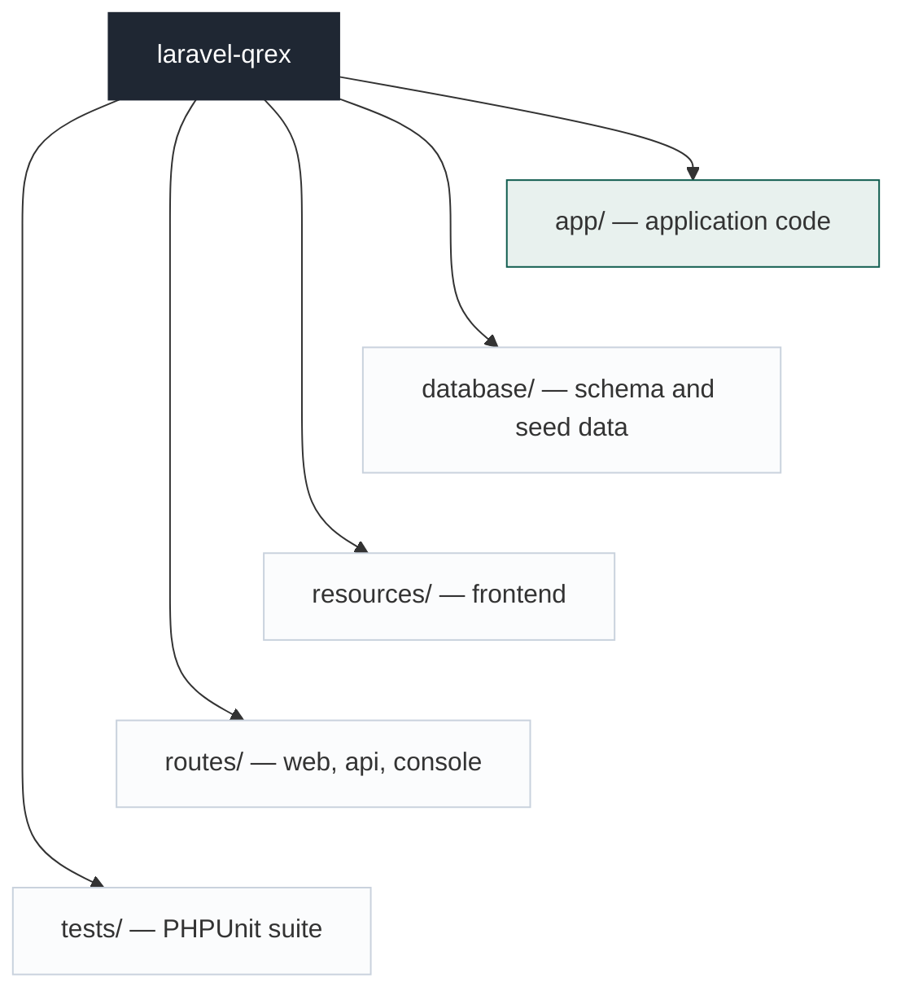
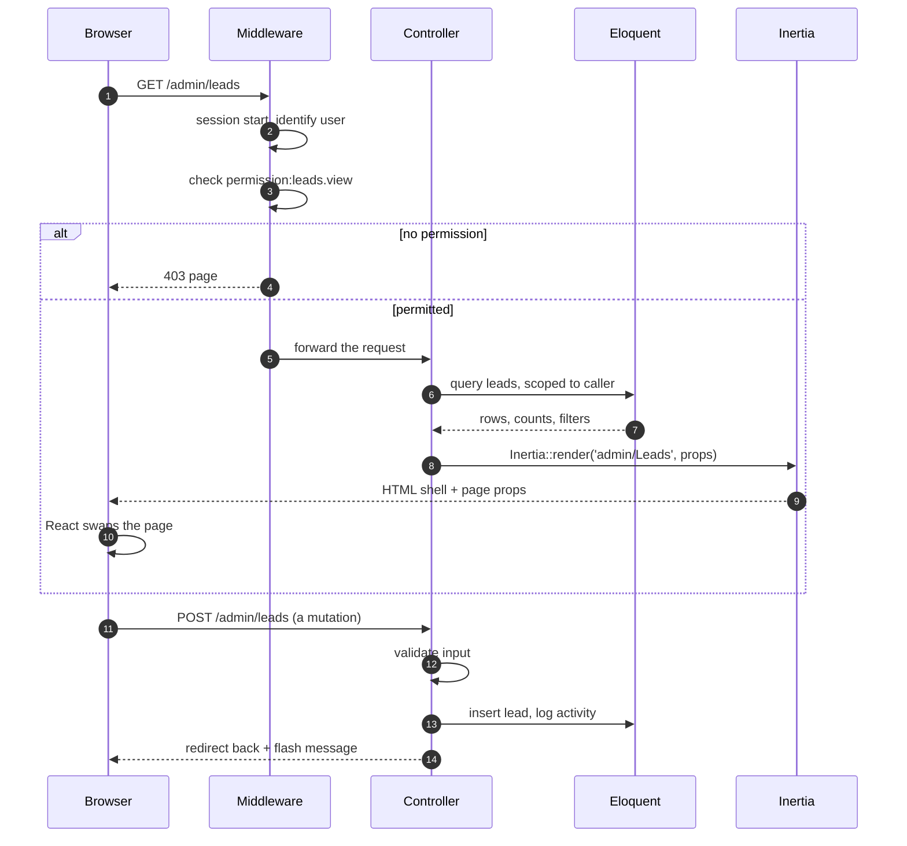

# 1. System at a Glance

*How QREX is put together: the surfaces people use, the modules they use them in, and what happens between a click and a saved record.*

---

## 1.1 Three surfaces, one system

QREX is not one screen with three modes — it is three separate surfaces that share one database and one permission model.

```mermaid caption="The three surfaces of QREX — public website, admin CRM, and the data underneath."
flowchart TB
  PUB["Public website — no login<br/><br/>Home · Property listings · Property detail<br/>Contact and enquiry forms"]
  ADM["Admin CRM — session login<br/><br/>17 modules · Pipeline board · Reports and exports"]
  API["JSON API — token auth<br/><br/>Sanctum tokens · Mobile-shaped endpoints"]
  DB[("Shared database")]

  PUB -->|"enquiry becomes a lead"| DB
  ADM --> DB
  API --> DB

  PUB ~~~ ADM
  ADM ~~~ API

  style PUB fill:#eef1f5,stroke:#c9d2dd
  style ADM fill:#e8f1ee,stroke:#0f5c4e
  style API fill:#eef1f5,stroke:#c9d2dd
  style DB fill:#fff8e8,stroke:#b5893b
```

| Surface | Who uses it | How it is reached | What it may do |
| --- | --- | --- | --- |
| **Public website** | Prospective buyers and renters | `/`, `/properties`, `/about`, `/contact` | Browse listings that are flagged visible; submit enquiries that become leads. Nothing else. |
| **Admin CRM** | Staff — agents, marketing, accounts, admins | `/admin/*`, behind session login | Everything: records, pipeline, bookings, payments, reports, administration. |
| **JSON API** | Integrations and mobile clients | `/api/*`, behind Sanctum tokens | The same modules as the admin CRM, shaped for machines. |

The **public website is the only place a record can be created without a login.** An enquiry submitted there becomes a lead with `source = Website`, and that is the entry point of the entire sales lifecycle.

---

## 1.2 The seventeen modules

The admin sidebar is not a flat list of twenty screens. It is four groups, and every item in it is a permission module — the same unit the permission matrix is built from.

```mermaid caption="The seventeen modules, grouped into the four navigation areas."
flowchart TB
  ADM["QREX Admin CRM — /admin<br/>17 modules in 4 groups"]

  G1["Overview<br/>Dashboard"]
  G2["Sales<br/>Properties · Leads · Customers · Sales Pipeline<br/>Site Visits · Tasks & Follow-ups · Bookings · Payments"]
  G3["Operations<br/>Media Center · Marketing<br/>Reports & Analytics · CMS / Website"]
  G4["Administration<br/>Users · Roles & Permissions · Amenities · Settings"]

  ADM --> G1
  ADM --> G2
  ADM --> G3
  ADM --> G4

  G1 ~~~ G2
  G2 ~~~ G3
  G3 ~~~ G4

  style ADM fill:#1f2733,stroke:#1f2733,color:#ffffff
  style G1 fill:#eef1f5,stroke:#c9d2dd
  style G2 fill:#e8f1ee,stroke:#0f5c4e
  style G3 fill:#eef1f5,stroke:#c9d2dd
  style G4 fill:#eef1f5,stroke:#c9d2dd
```

A module is hidden from the sidebar entirely if the signed-in user lacks its `view` permission. The same rule is applied on the server, so hiding a menu item is a courtesy, not the protection.

| Module | Owns | Key records |
| --- | --- | --- |
| **Dashboard** | The roll-up of everything below | Reads across all modules |
| **Properties** | The inventory being sold | `properties`, `property_images` |
| **Leads** | People who expressed interest | `leads`, `lead_activities`, `lead_handovers` |
| **Customers** | Buyers recorded on their own | `customers` |
| **Sales Pipeline** | Deals and the board they move across | `deals` |
| **Site Visits** | Scheduled property viewings | `site_visits` |
| **Tasks & Follow-ups** | To-dos, including next follow-ups | `tasks` |
| **Bookings** | The commercial commitment | `bookings` |
| **Payments** | Money received or expected | `payments` |
| **Media Center** | Uploaded files | `media_files` |
| **Marketing** | Campaigns and their spend | `campaigns` |
| **Reports & Analytics** | The numbers | Reads across all modules |
| **CMS / Website** | Public site content and featured listings | `settings`, `properties.featured` |
| **Users** | Staff accounts | `users` |
| **Roles & Permissions** | Who may do what | `roles`, `permissions`, two pivots |
| **Amenities** | The property feature catalogue | `amenities` |
| **Settings** | Agency identity, SMTP, feature toggles | `settings` |

---

## 1.3 The stack



The choice that shapes everything else is **Inertia**: controllers return *page props* rather than HTML strings, and Inertia resolves the matching React component and swaps the page in the browser. There is no separate API layer for the admin UI, and no client-side router to keep in sync with the server.

| Layer | Package | Version | Role in the system |
| --- | --- | --- | --- |
| Framework | Laravel | 13 | Routing, middleware, Eloquent, validation, queues, scheduling |
| Language | PHP | ^8.3 | Everything server-side |
| Bridge | Inertia | 3 | Controllers → React props → client-side page swap |
| Auth | Laravel Sanctum | 4 | Token auth for `/api/*` |
| PDF | barryvdh/laravel-dompdf | 3 | Report export to PDF |
| UI | React | 19 | Page rendering |
| Types | TypeScript | — | Typed frontend code |
| Styling | Tailwind CSS | 4 | Utility CSS |
| Build | Vite | 8 | Asset bundling and hot reload |
| Charts | Recharts | — | Dashboard and report visuals |

---

## 1.4 The repository layout



Each of those five directories holds a specific responsibility.

| Directory | What lives in it | Notes |
| --- | --- | --- |
| **`app/`** | Controllers (web and API), 19 Eloquent models, four services, the Artisan command, notifications and mailables | `Services/IdGenerator.php` produces every readable record ID; `Services/PermissionPayloadService.php` decides what the frontend may show. |
| **`database/`** | 33 schema and data migrations, 9 seeders, model factories | The seeders build the six roles, the permission catalogue, the demo users and a full set of sample listings, leads, deals, bookings and payments. |
| **`resources/`** | `js/pages` (Inertia page components), `js/components` (layout and shared UI), `views` (Blade shell and the report template), `css` | The report Blade template is what DomPDF turns into a PDF. |
| **`routes/`** | `web.php` (public and admin), `api.php` (Sanctum), `console.php` (the scheduled follow-up sweep) | `console.php` is where the daily 09:00 schedule is declared. |
| **`tests/`** | The PHPUnit suite | Covers the web routes, the controllers and the command behaviour. |

Two files inside `app/Services/` explain a lot of the behaviour elsewhere:

- **`IdGenerator.php`** — every human-readable record ID (`L-006`, `DL-012`) comes from here. It is the reason IDs are safe under concurrency.
- **`PermissionPayloadService.php`** — builds the permission payload the frontend receives on every request. It is the single source of truth for "can this user see that button".

---

## 1.5 What happens on a request



Three things in that sequence are worth calling out:

1. **The permission check happens before the controller.** A denied request never reaches business logic.
2. **The query is scoped, not filtered afterwards.** Row-level rules are part of the query, so an agent's list query returns fewer rows rather than the same rows with some hidden.
3. **Mutations redirect rather than return JSON.** The flash message is how the interface confirms what happened.

---

## 1.6 Reading the rest of this set

| Chapter | Answers the question |
| --- | --- |
| [02 The Sales Lifecycle](02-sales-lifecycle.md) | *What actually happens to a sale, step by step?* |
| [03 The Data Model](03-data-model.md) | *Where is this information stored, and how is it joined?* |
| [04 Roles and Permissions](04-roles-and-permissions.md) | *Who is allowed to see and change what?* |
| [05 Screen Designs](05-screen-designs.md) | *What does each screen look like, and what is each part for?* |
| [06 Operations and Automation](06-operations-and-automation.md) | *What happens on its own, without anyone clicking?* |

---

**Next:** [02 — The Sales Lifecycle](02-sales-lifecycle.md)
