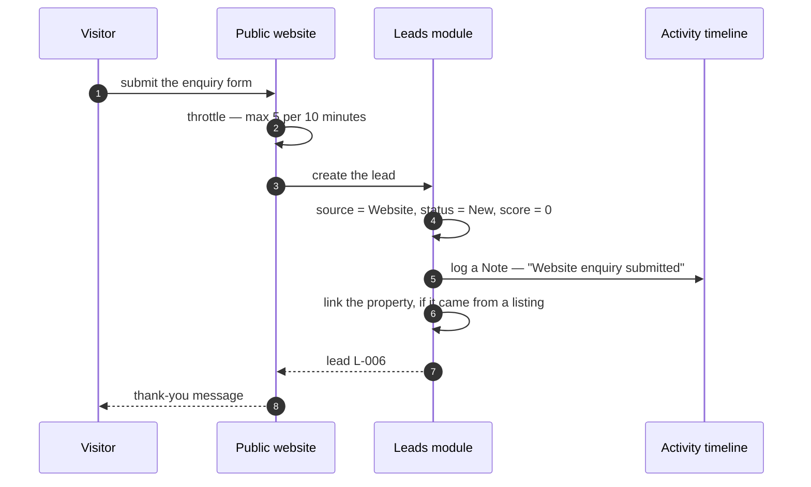
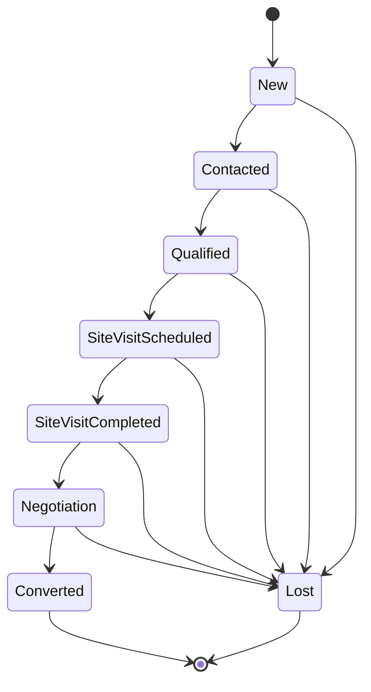
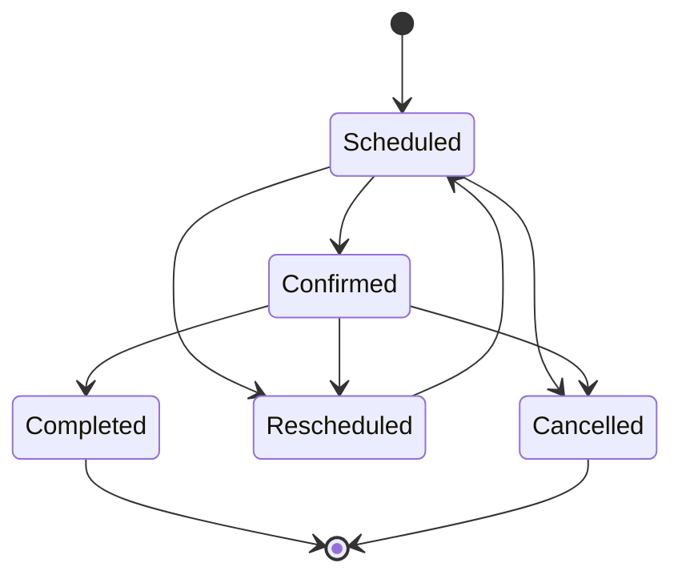
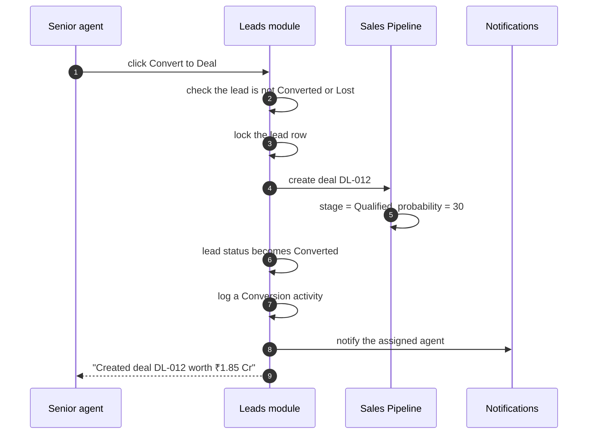
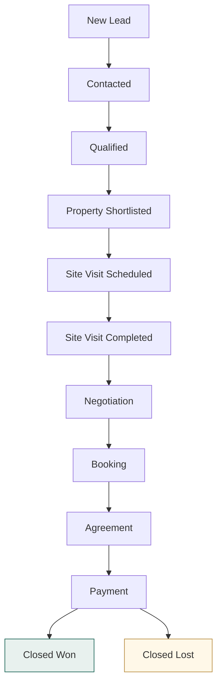
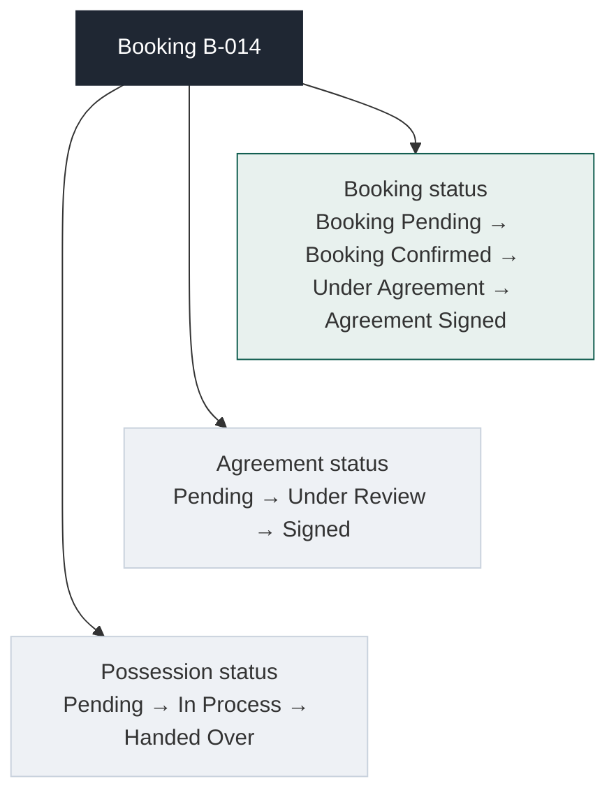
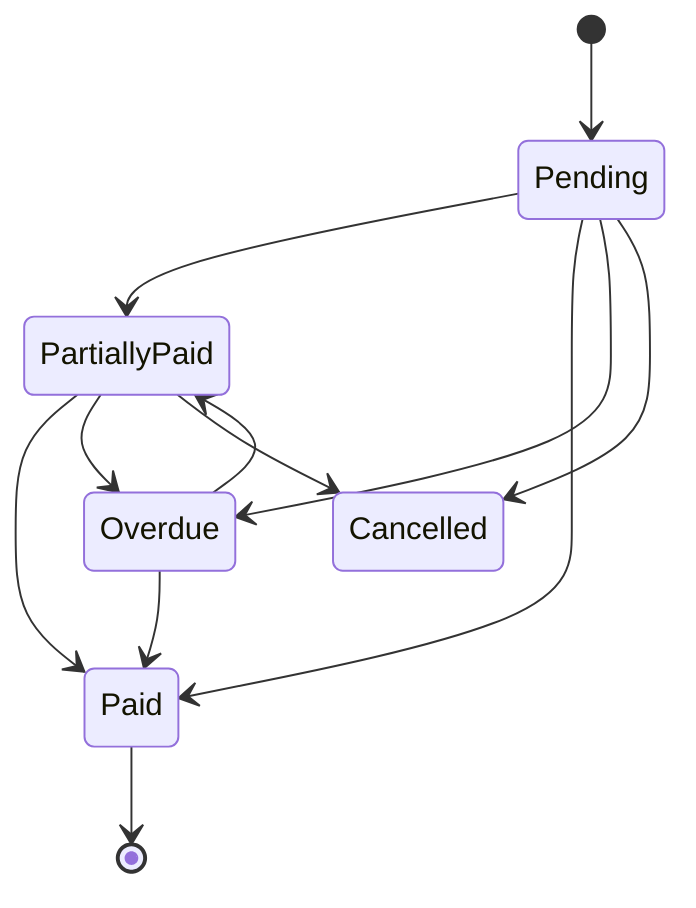

# 2. The Sales Lifecycle

*How one sale travels from a stranger filling in a form to money landing in the bank — and what the system does at each step.*

---

## 2.1 The nine steps

Every module in QREX exists to serve one of these nine steps. If a screen seems disconnected from the rest of the product, this list is where it usually lands.

```mermaid caption="The nine steps of a sale, and the two that the system performs by itself."
flowchart TB
  S1["1 · Enquiry arrives<br/>public website"]
  S2["2 · Lead created<br/>automatic, no human step"]
  S3["3 · First contact<br/>activity logged on the timeline"]
  S4["4 · Status progression<br/>New → … → Negotiation"]
  S5["5 · Site visit<br/>auto-created on the status change"]
  S6["6 · Convert to deal<br/>senior agent"]
  S7["7 · Deal moves on the board<br/>12 pipeline stages"]
  S8["8 · Booking raised<br/>the commercial commitment"]
  S9["9 · Payment recorded<br/>money moved"]

  S1 --> S2 --> S3 --> S4 --> S5 --> S6 --> S7 --> S8 --> S9

  style S2 fill:#e8f1ee,stroke:#0f5c4e
  style S5 fill:#e8f1ee,stroke:#0f5c4e
  style S6 fill:#fff8e8,stroke:#b5893b
```

| # | Step | Where it happens | Who acts | Module |
| --- | --- | --- | --- | --- |
| 1 | Enquiry arrives | Public website | Visitor | Public site |
| 2 | Lead created | Automatically | System | Leads |
| 3 | First contact, activity logged | Lead detail page | Agent | Leads |
| 4 | Status progression | Lead detail page | Agent | Leads |
| 5 | Site visit | Created by the status change | System, then agent | Site Visits |
| 6 | Convert to deal | Lead detail page | Senior agent | Leads → Sales Pipeline |
| 7 | Deal moves across the board | Pipeline board | Senior agent | Sales Pipeline |
| 8 | Booking raised | Bookings | Agent or accountant | Bookings |
| 9 | Payment recorded | Booking detail or Payments | Accountant | Payments |

Two steps are **automatic**: step 2 and the creation half of step 5. Nothing else happens without a person.

---

## 2.2 Step 1 to 2 — a visitor becomes a lead



The lead appears at the top of **Leads** with status `New`, and on the dashboard's *Recent leads* panel. Nobody has been assigned and no follow-up exists yet — **picking it up is a human responsibility**, and it is the step most often left undone.

---

## 2.3 Step 3 to 4 — contact and status

The **activity timeline** is the permanent record of the relationship. It is what a colleague reads when they take over a lead, and what management reads in the lead report.

| Activity type | Use it when | Outcome values |
| --- | --- | --- |
| **Call** | You phoned them | Connected · No Answer · Busy · Voicemail · Callback Requested · Not Interested |
| **WhatsApp** | You messaged them | Replied · Pending · Read |
| **SMS** | You texted them | Sent · Delivered · Pending |
| **Email** | You emailed them | Sent · Opened · Replied · Bounced |
| **Site Visit** | You arranged a visit | Scheduled · Completed · Cancelled · Rescheduled |
| **Meeting** | You met them | Scheduled · Completed · Cancelled · Rescheduled |
| **Note** | Anything worth recording | — |

Four more activity types are written by the system, never by hand: *Lead Imported*, *Status Change*, *Reassignment* and *Conversion*.

### The lead status machine



| Status | What it means | The obvious next action |
| --- | --- | --- |
| **New** | Arrived, nobody has touched it | Assign an agent, make first contact |
| **Contacted** | You have spoken to them | Log the outcome, set a follow-up |
| **Qualified** | Real budget, real intent, real requirement | Shortlist properties, schedule a visit |
| **Site Visit Scheduled** | A visit is on the calendar | Confirm it and run the visit |
| **Site Visit Completed** | They have seen the property | Record feedback, start negotiating |
| **Negotiation** | Terms are being discussed | Agree the deal and convert it |
| **Converted** | Became a deal — **terminal** | Work the deal on the pipeline board |
| **Lost** | Not going ahead — **terminal** | Record the reason |

### The next follow-up date is the engine

Setting a **next follow-up date** on the lead, or inside any activity, does three things at once:

1. Saves the date on the lead.
2. Creates or updates a **Follow-up task** (`TSK-###`) for the lead's agent — priority *High*, status *Pending*, or *Overdue* if the date has passed.
3. Stamps the lead's *last contact* to now.

Clearing the date **completes** the open follow-up task instead of deleting it, which keeps the audit trail intact. A date that cannot be parsed falls back to *tomorrow* rather than failing, and four date formats are accepted: `2026-10-21`, `2026/10/21`, `21-10-2026`, `21/10/2026`.

---

## 2.4 Step 5 — the site visit happens itself

The moment a lead's status becomes **Site Visit Scheduled**, the system creates a **Site Visit** (`SV-###`) for that lead — once only, never twice — dates it from the next-follow-up date (defaulting to tomorrow and 10:00 AM), names the property from the lead's interested property or preferred location, and notifies the assigned agent.



---

## 2.5 Step 6 — converting a lead into a deal



| Field on the conversion form | What to enter | Default |
| --- | --- | --- |
| **Deal value** | The agreed or expected property value | Required |
| **Property** | The property being bought | Falls back to the lead's interested property |
| **Stage** | Where the deal starts | **Qualified**, probability 30 |

Two guards protect the conversion: a lead that is already `Converted` or `Lost` cannot be converted, and the lead row is locked for the duration, so two people clicking at the same moment can never produce two deals from one lead.

A deal can also be created directly on the board, without a lead — useful for referral business that never generated an enquiry. A direct deal starts at **New Lead** with probability **10**; a converted deal starts at **Qualified** with probability **30**.

---

## 2.6 Step 7 — the pipeline board



Moving a card updates the stage, resets the *days in stage* counter and confirms with a toast. The summary bar above the board reports:

| Figure | Meaning |
| --- | --- |
| **Total** | All deals ever |
| **Pipeline Value** | Sum of the value of every active deal |
| **Active Count** | How many deals are live |
| **Expected Revenue** | Value × probability, summed — a weighted forecast |
| **Won Value / Won Count** | Total and number of Closed Won deals |
| **Lost Value** | Total value of Closed Lost deals |
| **Conversion Rate** | Won count ÷ total count |

`Booking`, `Agreement` and `Payment` on the board are **milestones**. The same three things are tracked properly in the Bookings and Payments modules — use the board to show progress, and those two modules to record what actually happened.

---

## 2.7 Steps 8 and 9 — booking and payment

A **booking** captures the commercial commitment: who, which property, which agent, when, for how much. It carries **three independent status tracks** that progress separately.



A realistic booking is *Booking Confirmed* while the agreement is still *Under Review* and possession is still *Pending*. The booking detail page draws all three as one timeline so the whole state is visible at once.

A **payment** is money that has moved, or is expected to. **QREX records payments; it never collects them** — there is no gateway, no card processing, nothing is charged.



| Field | Notes |
| --- | --- |
| **Customer name** | Required |
| **Property name** | Optional |
| **Amount** | The instalment or sum due |
| **Mode** | RTGS · NEFT · IMPS · UPI · Cheque · Bank Transfer · Cash |
| **Due date** | When it is expected |
| **Status** | Pending · Partially Paid · Paid · Overdue |

Recording a payment from the booking detail page is the fast path: it creates a `PAY-###` with status **Paid**, today's date as both the due date and the paid date, and a transaction reference of `—`.

---

## 2.8 What rolls up automatically

Nobody has to "report" anything. Every figure on the dashboard and in the reports is derived from the records above.

| Dashboard or report figure | Where it comes from |
| --- | --- |
| Active leads, new leads | Leads that are not closed |
| Active deals | Deals that are neither Closed Won nor Closed Lost |
| Revenue won | Sum of deal value across Closed Won deals |
| Pipeline value | Sum of the value of active deals |
| Expected revenue | Deal value × probability |
| Pending payments | Payments that are neither Paid nor Cancelled |
| Lead sources | Grouped by the lead's `source` field |
| Pipeline funnel | Deal count and value per stage |
| Agent performance | Closed-won deals and revenue per agent |
| Conversion rate | Won ÷ total |
| Lost leads | Leads that ended in `Lost`, broken down by source |
| Site-visit report | Scheduled, completed, cancelled and rescheduled totals |
| Campaign performance | Budget, spend, leads, conversions and ROI per campaign |

---

**Next:** [03 — The Data Model](03-data-model.md)
