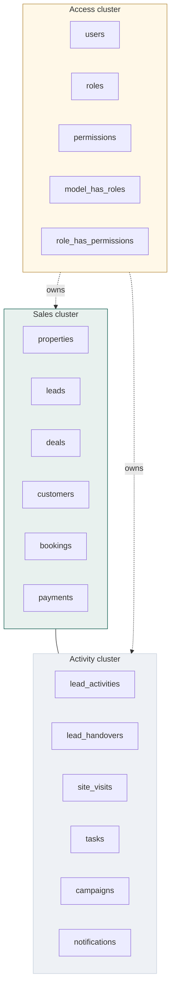
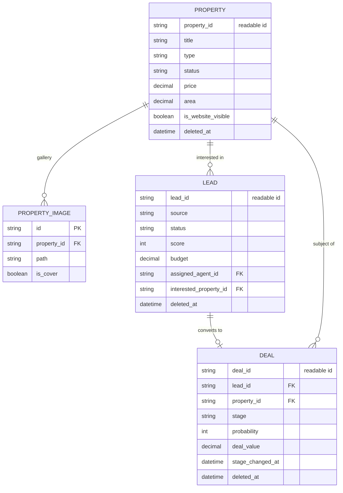
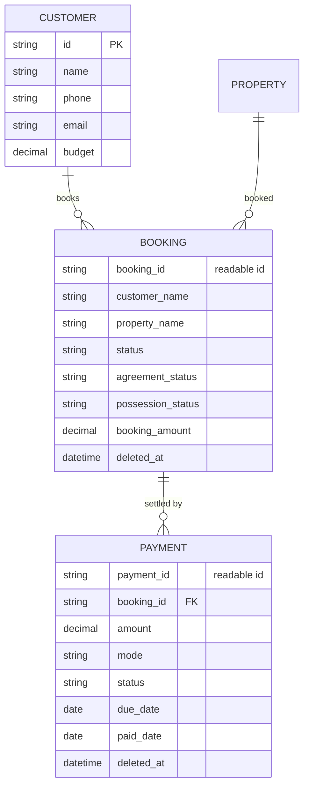
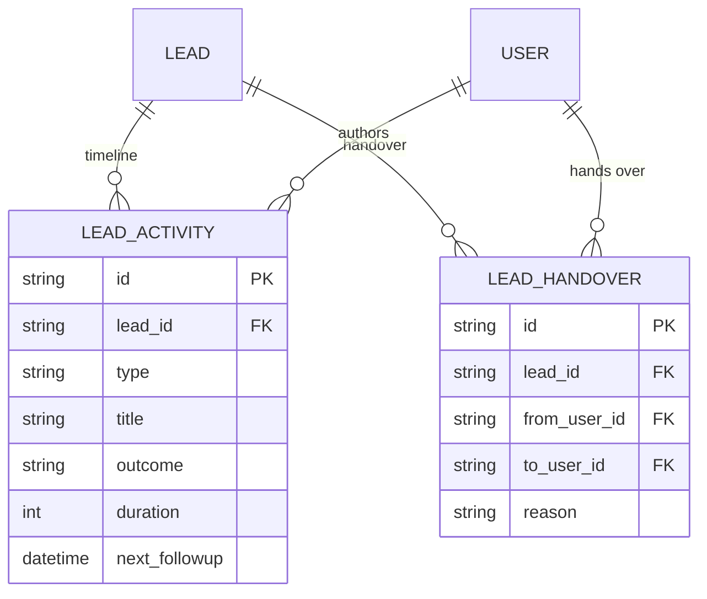
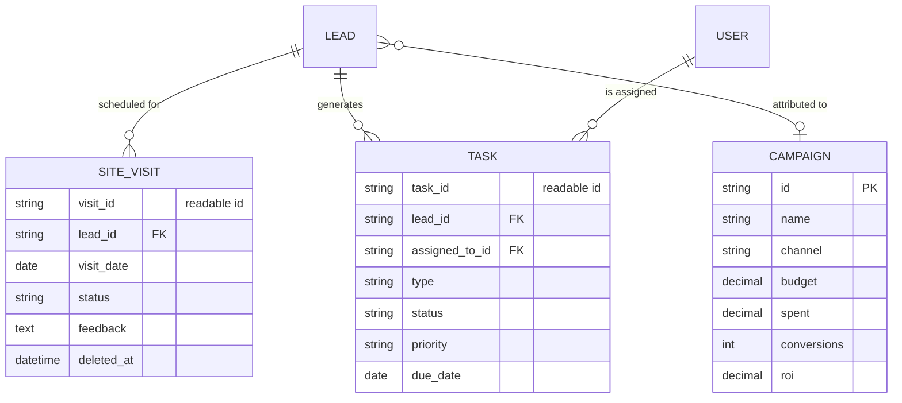
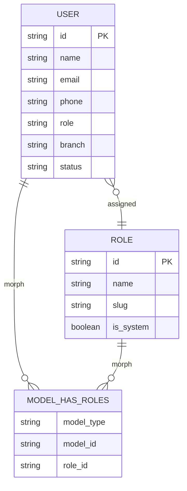
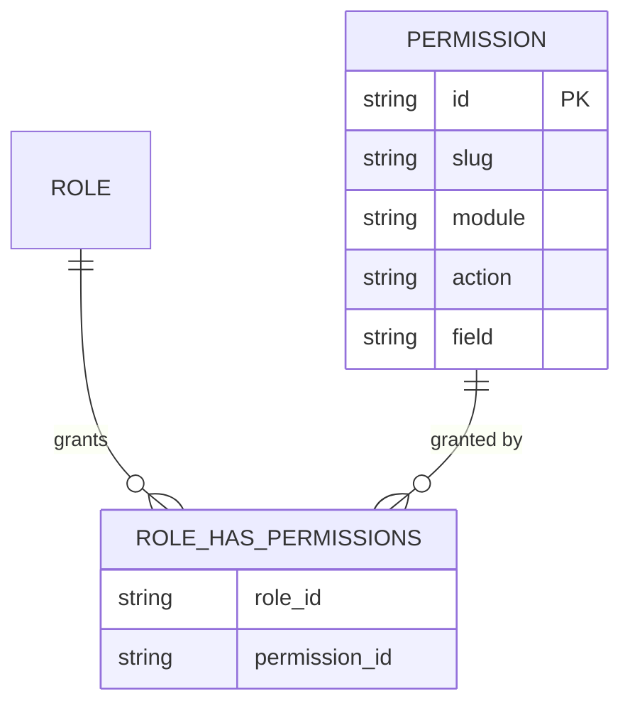
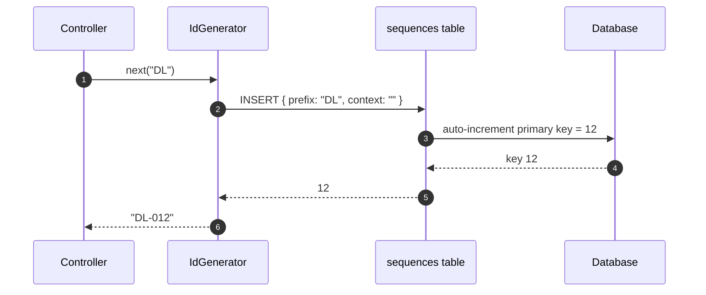

# 3. The Data Model

*Thirty tables, one set of relationships. This chapter shows where each piece of the business actually lives.*

---

## 3.1 The shape of the system

The data model has three clusters that only meet at the edges.

- The **sales cluster** holds the commercial truth: what exists, who wants it, what was agreed and what was paid.
- The **activity cluster** holds the evidence: what was said, when, and by whom.
- The **access cluster** holds the rules: who may see and change what.

The activity cluster is deliberately separate from the sales cluster. A lead can be deleted from the pipeline view and still have a complete activity history behind it.

---

## 3.2 The sales core

Property, Lead and Deal are the three records the whole business turns on. Everything else hangs off them.

Note the two different kinds of relationship on the diagram. `PROPERTY ||--o{ LEAD` is a **one-to-many** — a property can interest many leads. `LEAD ||--o| DEAL` is **one-to-zero-or-one** — a lead produces at most one deal, and a deal may exist without a lead (a direct board deal). The second guard on conversion exists precisely to protect that "at most one".

---

## 3.3 The commitment and the money

---

## 3.4 The evidence trail

---

## 3.5 The access cluster

`model_has_roles` is a **polymorphic** pivot, so any model can hold a role without a dedicated join table. `role_has_permissions` is a plain many-to-many pivot.

---

## 3.5 Every table, in one list

| Table | Purpose | Key columns |
| --- | --- | --- |
| `users` | Staff accounts | `name`, `email`, `phone`, `role`, `branch`, `status`, `avatar`, `last_login_at` |
| `roles` | The six roles | `name`, `slug`, `description`, `is_system` |
| `permissions` | Every rule | `name`, `slug`, `module`, `action`, `field` |
| `role_has_permissions` | Role → permission | `role_id`, `permission_id` |
| `model_has_roles` | Model → role (polymorphic) | `model_type`, `model_id`, `role_id` |
| `properties` | The inventory | `property_id`, `title`, `type`, `status`, `price`, `area`, `featured`, `is_website_visible` |
| `property_images` | Per-property gallery | `property_id`, `path`, `is_cover` |
| `leads` | People who expressed interest | `lead_id`, `source`, `status`, `score`, `budget`, `assigned_agent_id`, `owner_id`, `created_by` |
| `lead_activities` | The timeline | `type`, `title`, `description`, `outcome`, `duration`, `contact_number`, `email_subject`, `next_followup`, `location` |
| `lead_handovers` | Reassignment history | `from_user_id`, `to_user_id`, `reason`, `notes` |
| `deals` | Deals and their stage | `deal_id`, `lead_id`, `property_id`, `stage`, `probability`, `deal_value`, `stage_changed_at` |
| `customers` | Buyers in their own right | `name`, `phone`, `email`, `type`, `budget`, `notes` |
| `site_visits` | Scheduled viewings | `visit_id`, `lead_id`, `visit_date`, `visit_time`, `status`, `feedback`, `notes` |
| `bookings` | The commercial commitment | `booking_id`, `status`, `agreement_status`, `possession_status`, `deal_value`, `booking_amount` |
| `payments` | Money received or expected | `payment_id`, `booking_id`, `amount`, `mode`, `status`, `due_date`, `paid_date` |
| `campaigns` | Marketing efforts | `name`, `channel`, `budget`, `spent`, `leads_count`, `conversions`, `revenue`, `roi`, `status` |
| `media_files` | Uploads | `path`, `disk`, `mime`, `size` |
| `notifications` | In-app messages | `user_id`, `title`, `message`, `type`, `related_id`, `is_read`, `is_seen` |
| `tasks` | Follow-ups and to-dos | `task_id`, `lead_id`, `assigned_to_id`, `created_by`, `type`, `status`, `priority`, `due_date` |
| `settings` | Key/value configuration | `key`, `value`, `group` |
| `email_otps` | One-time passcodes | `user_id`, `email`, `purpose`, `new_email`, hashed `code`, `expires_at`, `used_at` |
| `sequences` | Readable-ID generator | `prefix`, `context` |
| `amenities` | Property feature catalogue | `name`, `type`, `icon` |
| `personal_access_tokens` | Sanctum API tokens | standard Laravel columns |
| `sessions`, `cache`, `jobs`, `job_batches` | Framework tables | standard Laravel columns |

---

## 3.6 Soft deletes

The primary business entities are **soft-deleted**, so a removed record stays queryable and reportable.

| Soft-deleted | Hard-deleted |
| --- | --- |
| `leads`, `properties`, `customers`, `deals`, `bookings`, `payments`, `site_visits`, `media_files` | `roles` and `permissions` — force-deleted only when the seeder rebuilds them |

This is why a deleted lead still appears in a historical report: the row is still there with a `deleted_at` timestamp, and the report queries filter on it.

---

## 3.7 Readable record IDs

Every business record carries a human-readable identifier so it can be quoted on a phone call.

| Prefix | Record | Example |
| --- | --- | --- |
| `L` | Lead | `L-006` |
| `DL` | Deal | `DL-012` |
| `TSK` | Task | `TSK-007` |
| `SV` | Site visit | `SV-003` |
| `B` | Booking | `B-014` |
| `PAY` | Payment | `PAY-021` |

The number is the **auto-increment primary key** of the `sequences` row, zero-padded to three digits. Because uniqueness comes from the database rather than from a read-then-write check, two concurrent requests can never be handed the same ID.

---

## 3.8 Indexes on the hot paths

The enterprise hardening migration indexes the columns that reports and dashboards actually filter on.

| Table | Indexed columns |
| --- | --- |
| `leads` | `phone`, `status`, `source`, `assigned_agent_id`, `created_at` |
| `deals` | `stage`, `assigned_agent_id`, `lead_id` |
| `payments` | `status`, `due_date` |
| `bookings` | `status`, `booking_date` |
| `site_visits` | `status`, `lead_id`, `visit_date` |
| `tasks` | `lead_id`, `status`, `assigned_to_id` |
| `notifications` | `user_id`, `is_read`, `created_at` |
| `lead_activities` | `lead_id` |
| `property_images` | `property_id` |

---

## 3.9 Settings as a key/value store

`settings` is a generic `key` / `value` / `group` table. Keys are grouped, and the most important group is `general`, which holds the agency's identity.

| Group | Keys | Purpose |
| --- | --- | --- |
| `general` | `project_name`, `agency_name`, `tagline`, `contact_email`, `contact_phone`, `address`, `currency`, `timezone`, social links, office hours, SEO defaults | Identity, branding and regional defaults |
| `branding` | `logo_url` and related keys | Logo and colours used by the app shell and the public site |
| `smtp_*` | `smtp_enabled`, `smtp_host`, `smtp_port`, `smtp_username`, `smtp_password`, `smtp_encryption`, `smtp_from_address`, `smtp_from_name`, `smtp_test_email` | Outgoing email, managed from the Settings page rather than `.env` |
| Feature toggles | `enable_contact_form`, `maintenance_mode`, `lead_auto_assign`, `visit_reminders`, `payment_alerts` | Switches behaviour on and off without a code change |

Saved values are merged **over** the controller's defaults, so a missing key is never a null pointer — it falls back to the built-in value.

---

**Next:** [04 — Roles and Permissions](04-roles-and-permissions.md)
