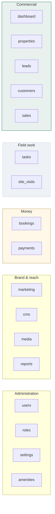
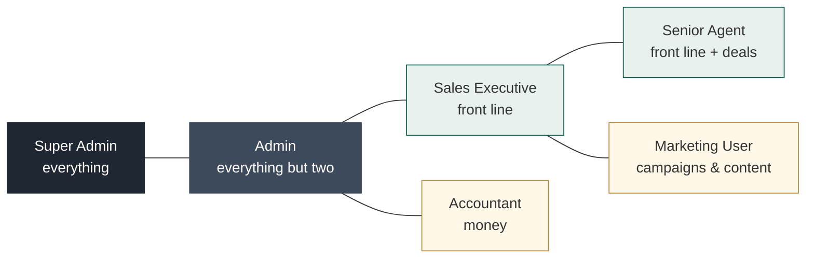
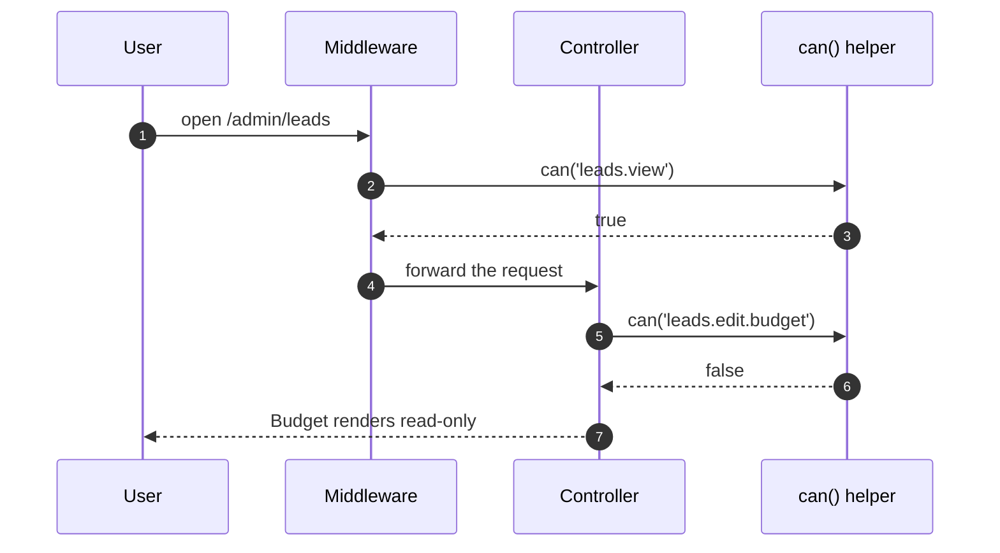
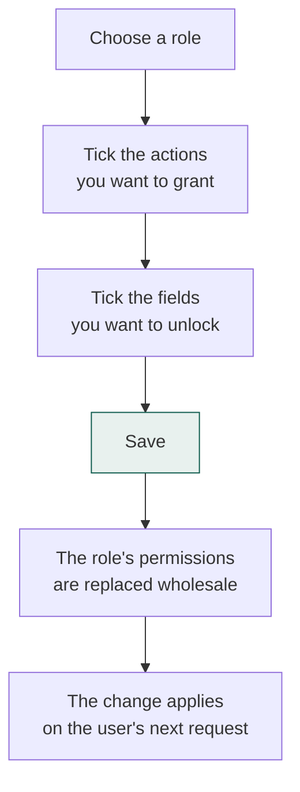

# 4. Roles and Permissions

*Six roles, seventeen modules, one rule: a permission says what you may **do**, and a field permission says what you may **change**.*

---

## 4.1 The two-layer model

QREX separates *module access* from *field access*. The first layer decides which pages exist in your navigation; the second decides which inputs on those pages are editable.

```mermaid caption="Module access and field access are two different questions."
flowchart TB
  U["Signed-in user"]
  R["Their role<br/>(one of six)"]
  P["Permissions granted<br/>to that role"]
  M["Module access<br/>can they open the page?"]
  F["Field access<br/>can they change this input?"]

  U --> R --> P
  P --> M
  P --> F
  M --> V["Data they can read"]
  F --> W["Data they can change"]

  style U fill:#1f2733,stroke:#1f2733,color:#ffffff
  style M fill:#e8f1ee,stroke:#0f5c4e
  style F fill:#fff8e8,stroke:#b5893b
```

| Layer | Example slug | Effect |
| --- | --- | --- |
| **Module action** | `leads.view` | The Leads navigation item appears and the page loads |
| **Module action** | `leads.delete` | The delete button appears on a lead |
| **Field action** | `leads.edit.budget` | The *Budget* input is editable; without it the field is shown read-only |

A permission row stores four things: `module`, `action`, `field` and `description`. Module-level permissions have a `null` field; field-level permissions name the field.

---

## 4.2 The seventeen modules



| Module | Actions available | Editable fields |
| --- | --- | --- |
| `dashboard` | view | — |
| `properties` | view, create, edit, delete, export | price, title, status, description, area, bedrooms, bathrooms, amenities, featured, agent |
| `leads` | view, create, edit, delete, export | name, phone, email, source, status, budget, assigned_agent, score |
| `customers` | view, create, edit, delete, export | name, phone, email, type, budget, notes |
| `sales` | view, create, edit, delete, export | — |
| `tasks` | view, create, edit, delete | title, status, priority, due_date, assigned_to |
| `site_visits` | view, create, edit, delete | date, time, status, feedback, notes |
| `bookings` | view, create, edit, delete, **approve** | amount, status, payment_mode, notes |
| `payments` | view, create, edit, delete, export | amount, status, mode, date, notes |
| `media` | view, create, delete | — |
| `marketing` | view, create, edit, delete, export | name, budget, status, channels, content |
| `reports` | view, export | — |
| `cms` | view, create, edit, delete | content, featured, seo |
| `users` | view, create, edit, delete | name, email, phone, role, branch, status, password |
| `settings` | view, edit | project_name, agency_name, contact_email, contact_phone, address, tagline, logo |
| `roles` | view, create, edit, delete | — |
| `amenities` | view, create, edit, delete | — |

`bookings.approve` is the only action unique to one module — it is what lets the accountant approve a booking while a sales executive cannot.

---

## 4.3 The six roles



| Role | Is a system role? | What it is for |
| --- | --- | --- |
| **Super Admin** | Yes | Full access to everything, including the two things Admin cannot do |
| **Admin** | Yes | Day-to-day administration of the whole system |
| **Sales Executive** | No | Front-line selling: properties, leads, customers, tasks, site visits |
| **Senior Agent** | No | Front-line selling plus the deal board and lead conversion |
| **Marketing User** | No | Campaigns, website content and media |
| **Accountant** | No | Bookings, payments and financial reports |

| Role | What it can reach |
| --- | --- |
| **Super Admin** | All 17 modules, all actions, all fields |
| **Admin** | Everything except `settings.edit.project_name` and `roles.delete` |
| **Sales Executive** | dashboard, properties (v/c/e), leads (v/c/e + 7 fields), customers (v/c/e), tasks (v/c/e), site visits (v/c/e), media (v/c), reports (view) |
| **Senior Agent** | Everything Sales Executive has, **plus** `sales.view`, `sales.create`, `sales.edit` — the deal board — **plus** the `leads.edit.source` field |
| **Marketing User** | dashboard, leads (view/create), marketing (v/c/e), media (v/c), cms (v/c/e), reports (view + export) |
| **Accountant** | dashboard, customers (view), sales (view), bookings (v/c/e), payments (v/c/e), reports (view + export), media (view) |

Note what is **missing** everywhere: nobody can delete a role except the Super Admin, and nobody can rename the project except the Super Admin. Those two omissions are the only difference between Super Admin and Admin.

---

## 4.4 The full matrix

A tick means the role holds that permission.

| Module · action | Super Admin | Admin | Sales Exec | Senior Agent | Marketing | Accountant |
| --- | :---: | :---: | :---: | :---: | :---: | :---: |
| `dashboard.view` | ● | ● | ● | ● | ● | ● |
| `properties.view` | ● | ● | ● | ● | | |
| `properties.create` | ● | ● | ● | ● | | |
| `properties.edit` | ● | ● | ● | ● | | |
| `properties.delete` | ● | ● | | | | |
| `properties.export` | ● | ● | | | | |
| `leads.view` | ● | ● | ● | ● | ● | |
| `leads.create` | ● | ● | ● | ● | ● | |
| `leads.edit` | ● | ● | ● | ● | | |
| `leads.delete` | ● | ● | | | | |
| `leads.export` | ● | ● | | | | |
| `customers.view` | ● | ● | ● | ● | | ● |
| `customers.create` | ● | ● | ● | ● | | |
| `customers.edit` | ● | ● | ● | ● | | |
| `customers.delete` | ● | ● | | | | |
| `customers.export` | ● | ● | | | | |
| `sales.view` | ● | ● | | ● | | ● |
| `sales.create` | ● | ● | | ● | | |
| `sales.edit` | ● | ● | | ● | | |
| `sales.delete` | ● | ● | | | | |
| `sales.export` | ● | ● | | | | |
| `tasks.view` | ● | ● | ● | ● | | |
| `tasks.create` | ● | ● | ● | ● | | |
| `tasks.edit` | ● | ● | ● | ● | | |
| `tasks.delete` | ● | ● | | | | |
| `site_visits.view` | ● | ● | ● | ● | | |
| `site_visits.create` | ● | ● | ● | ● | | |
| `site_visits.edit` | ● | ● | ● | ● | | |
| `site_visits.delete` | ● | ● | | | | |
| `bookings.view` | ● | ● | | | | ● |
| `bookings.create` | ● | ● | | | | ● |
| `bookings.edit` | ● | ● | | | | ● |
| `bookings.delete` | ● | ● | | | | |
| `bookings.approve` | ● | ● | | | | ● |
| `payments.view` | ● | ● | | | | ● |
| `payments.create` | ● | ● | | | | ● |
| `payments.edit` | ● | ● | | | | ● |
| `payments.delete` | ● | ● | | | | |
| `payments.export` | ● | ● | | | | |
| `media.view` | ● | ● | ● | ● | ● | ● |
| `media.create` | ● | ● | ● | ● | ● | |
| `media.delete` | ● | ● | | | | |
| `marketing.view` | ● | ● | | | ● | |
| `marketing.create` | ● | ● | | | ● | |
| `marketing.edit` | ● | ● | | | ● | |
| `marketing.delete` | ● | ● | | | | |
| `marketing.export` | ● | ● | | | | |
| `reports.view` | ● | ● | ● | ● | ● | ● |
| `reports.export` | ● | ● | ● | | ● | ● |
| `cms.view` | ● | ● | | | ● | |
| `cms.create` | ● | ● | | | ● | |
| `cms.edit` | ● | ● | | | ● | |
| `cms.delete` | ● | ● | | | | |
| `users.view` | ● | ● | | | | |
| `users.create` | ● | ● | | | | |
| `users.edit` | ● | ● | | | | |
| `users.delete` | ● | ● | | | | |
| `roles.view` | ● | ● | | | | |
| `roles.create` | ● | ● | | | | |
| `roles.edit` | ● | ● | | | | |
| `roles.delete` | ● | | | | | |
| `settings.view` | ● | ● | | | | |
| `settings.edit` | ● | ● | | | | |
| `settings.edit.project_name` | ● | | | | | |
| `amenities.view` | ● | ● | | | | |
| `amenities.create` | ● | ● | | | | |
| `amenities.edit` | ● | ● | | | | |
| `amenities.delete` | ● | ● | | | | |

### Field-level permissions

Field permissions exist for eight modules only. They are the mechanism that lets an admin edit a lead's score without letting a sales executive change who the lead is assigned to.

| Module | Field-level permissions |
| --- | --- |
| `properties` | price, title, status, description, area, bedrooms, bathrooms, amenities, featured, agent |
| `leads` | name, phone, email, source, status, budget, assigned_agent, score |
| `customers` | name, phone, email, type, budget, notes |
| `tasks` | title, status, priority, due_date, assigned_to |
| `site_visits` | date, time, status, feedback, notes |
| `bookings` | amount, status, payment_mode, notes |
| `payments` | amount, status, mode, date, notes |
| `marketing` | name, budget, status, channels, content |
| `cms` | content, featured, seo |
| `users` | name, email, phone, role, branch, status, password |
| `settings` | project_name, agency_name, contact_email, contact_phone, address, tagline, logo |

| Field permission | Sales Executive | Senior Agent |
| --- | :---: | :---: |
| `leads.edit.name` | ● | ● |
| `leads.edit.phone` | ● | ● |
| `leads.edit.email` | ● | ● |
| `leads.edit.source` | | ● |
| `leads.edit.status` | ● | ● |
| `leads.edit.budget` | ● | ● |
| `leads.edit.assigned_agent` | ● | ● |
| `leads.edit.score` | ● | ● |

Senior Agent has exactly one field permission that Sales Executive does not: `leads.edit.source`. That single extra permission is what allows a senior agent to correct where a lead came from.

---

## 4.5 How a permission is enforced



Three levels of enforcement, from broadest to narrowest:

| Level | Where | What it stops |
| --- | --- | --- |
| **Navigation** | The sidebar is built from the user's permissions | A menu item you cannot use never appears |
| **Route** | Middleware on the route | Directly typing the URL gets you a 403, not a blank page |
| **Field** | The edit form checks each field | An input you may not change renders read-only instead of disappearing |

A user with no permissions at all still reaches the dashboard, which explains the empty state rather than showing an error — the dashboard simply reports nothing, because it only reports what you are allowed to see.

---

## 4.6 Changing a role

Roles are edited on the **Roles** page, where each role lists every module as a row of checkboxes — one per action — plus the field permissions underneath.



Two behaviours worth knowing:

- Saving **replaces** the role's permission set rather than merging into it. Whatever you untick is gone the moment you save.
- The four system roles — Super Admin, Admin, Sales Executive and Senior Agent — are seeded with `is_system = true`. They can be edited, but they are re-created from the seeder on every deployment, so a hand-made change to a system role does not survive a deploy. **Custom roles** created from the Roles page are yours and are not touched by the seeder.

---

**Next:** [05 — Screen Designs](05-screen-designs.md)
