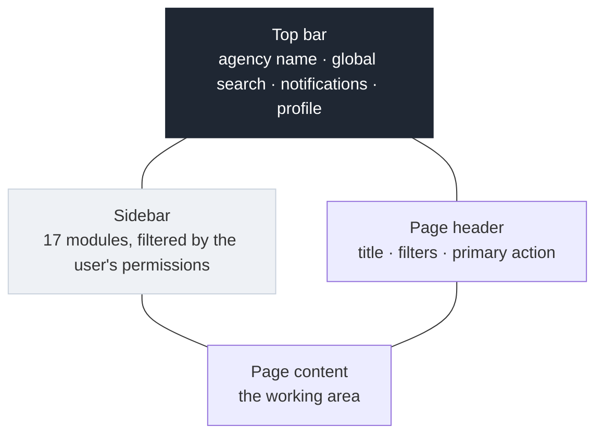

# 5. Screen Designs

*Annotated wireframes of the nine screens that matter most.*

These are not pixel-perfect mockups. They are **layout diagrams** drawn to scale — they show where each region of the screen sits, what it contains, and how the regions relate to one another. Read them alongside the captions; the labels inside each block are the annotation.

---

## 5.1 How the app shell is put together

Every screen in QREX sits inside the same frame, and the frame is the same on every page.



| Region | Always present | Contents |
| --- | --- | --- |
| **Top bar** | Yes | Agency name, global search, notification bell with unread count, user menu |
| **Sidebar** | Yes | Overview, Sales, Operations and Administration groups — a module you lack permission for is not drawn |
| **Page header** | Yes | Page title, contextual filters, the primary action button |
| **Content** | Varies | Tables, forms, boards, charts and panels |

The four nav groups hold seventeen modules in total:

| Group | Modules |
| --- | --- |
| **Overview** | Dashboard |
| **Sales** | Properties · Leads · Customers · Sales Pipeline · Site Visits · Tasks & Follow-ups · Bookings · Payments |
| **Operations** | Media Center · Marketing · Reports & Analytics · CMS / Website |
| **Administration** | Users · Roles & Permissions · Amenities · Settings |

---

## 5.2 Dashboard

```wireframe dashboard caption="Dashboard — the daily landing page. Four headline numbers, two charts, and the two lists that need action today."
```

| Region | What it shows | Why it is there |
| --- | --- | --- |
| **Stat cards** | New leads · Site visits due · Deals in pipeline · Revenue this month | The four numbers a manager opens the app to check |
| **Revenue by month** | Area chart of won revenue over time | Is the month ahead of or behind the last one? |
| **Lead sources** | Pie chart grouped by the lead's source | Where is the business coming from? |
| **Recent leads** | The newest leads, whoever owns them | What just arrived while I was away? |
| **Follow-ups due today** | Overdue and today's follow-ups | What will I be chased about if I do nothing? |

The stat cards respond to the date-range filter in the header. Everything on this page is permission-filtered — a role without `reports.view` sees the cards and the lists but no chart data it is not entitled to.

---

## 5.3 Leads list

```wireframe leads-list caption="Leads — the working list. Filter, scan, act."
```

| Region | What it shows |
| --- | --- |
| **Filters** | Status · source · assigned agent · date range · free-text search |
| **Rows** | ID · name · source · status · agent · next follow-up · value |
| **Pagination** | Page size and page navigation |
| **Import note** | CSV import resolves agents, campaigns and properties by name, and reports what it could not resolve |
| **Scope note** | Row-level scope — an agent sees their own leads and their branch's leads; a manager sees everything |

The **next follow-up** column is the column to sort by. A lead with no follow-up date is the most common way a sale dies quietly.

---

## 5.4 Lead detail

```wireframe lead-detail caption="Lead detail — the record of one person, and the place the work happens."
```

| Region | What it shows |
| --- | --- |
| **Header** | Lead ID, name, status chip, and the two consequential actions: *Reassign* and *Convert to deal* |
| **Lead fields** | Source, score, phone, email, budget, requirements — each editable only if your role holds that field permission |
| **Follow-up panel** | Next follow-up date, schedule a site visit, linked property |
| **Activity timeline** | Calls, WhatsApp, SMS, e-mail, notes and the auto-generated events, newest first |
| **Action bar** | Log activity · Change status · Convert to deal |

The timeline is the part that matters most. It is written to be read by somebody who was not there: what was said, what was agreed, and what happens next.

---

## 5.5 Sales pipeline board

```wireframe pipeline caption="Sales pipeline — twelve stages, six columns visible at a time, cards dragged between stages."
```

| Region | What it shows |
| --- | --- |
| **Header** | Stage filter and owner filter |
| **Columns** | The twelve stages, grouped into six columns; the last column holds Booking, Payment and Closed |
| **Cards** | Deal name, value, property, agent, days in stage |
| **Summary bar** | Total · pipeline value · active count · expected revenue · won value · lost value · conversion rate |

Dragging a card changes the stage, resets the *days in stage* counter and raises a confirmation. The expected-revenue figure is the weighted one — value × probability — and it is the number to plan against.

---

## 5.6 Property create and edit

```wireframe property-form caption="Property form — core details, commercial details, type-driven specifications, amenities and the image gallery."
```

| Region | What it shows |
| --- | --- |
| **Core** | Title, property type, transaction type, status |
| **Commercial** | Price, area, location, agency, featured, website-visible |
| **Specifications** | Which specification fields appear is driven by the chosen property type — an apartment is asked for floor and lift; a plot is asked for facing and boundary |
| **Amenities** | Chosen from the catalogue of amenities for that property type |
| **Gallery** | Upload, reorder, choose the cover image, delete |

`Website visible` decides whether the property appears on the public site at all. `Featured` decides whether it is highlighted there. Both are one tick away, so it is worth knowing which one you are clicking.

---

## 5.7 Bookings and payments

```wireframe operations caption="Bookings and payments — the commitment on top, the money underneath."
```

| Region | What it shows |
| --- | --- |
| **Bookings table** | ID · customer · property · value · agreement status · possession status |
| **Payments table** | ID · booking · amount · due date · paid date · status |
| **Booking status filter** | Pending · Confirmed · Under Agreement · Agreement Signed |
| **Payment status filter** | Pending · Partially Paid · Paid · Overdue |

The booking row carries **three** status columns, because the booking, the agreement and the possession progress independently. A booking can be confirmed while the agreement is still under review — that is normal, and the columns let you see it.

Recording a payment from here creates a `PAY-###` record linked to the booking. QREX records the money; it never collects it.

---

## 5.8 Reports and analytics

```wireframe reports caption="Reports — eight report families behind one page, each exportable as CSV or PDF."
```

| Report family | Answers |
| --- | --- |
| **Sales** | What did we sell, and when? |
| **Leads** | Where did the leads come from, and how many converted? |
| **Pipeline** | How much is in flight, and at what stage? |
| **Payments** | What is due, what is overdue, what is settled? |
| **Agents** | How is each agent performing? |
| **Properties** | Which properties get attention, and which get none? |
| **Site visits** | How many visits were scheduled, completed, cancelled or rescheduled? |
| **Bookings** | What is committed, and in what state? |

The report tabs sit in a filter strip above the content, with the date range and the two export buttons in the header. Every chart is backed by a table view of the same numbers, so nothing can only be seen as a picture.

---

## 5.9 Roles and permissions

```wireframe roles caption="Roles — six roles, seventeen modules, and a matrix of actions and fields."
```

| Region | What it shows |
| --- | --- |
| **Role list** | The six roles, with the system roles marked |
| **Module rows** | One row per module, one checkbox per action |
| **Field rows** | Nested under the module, one checkbox per editable field |
| **Save** | Replaces the role's permission set wholesale |

The screen is dense on purpose. This is the one page where a single mis-click changes what a colleague can see for the rest of the day, and where the safest habit is to expand one module at a time.

---

## 5.10 The public website

```wireframe public-listing caption="Public website — the only part of QREX an unauthenticated visitor ever sees."
```

| Region | What it shows |
| --- | --- |
| **Header** | Agency branding from settings, navigation, phone number |
| **Hero** | The headline, the search entry point |
| **Property grid** | Only properties flagged `website visible` |
| **Property card** | Cover image, title, type, price, area, location |
| **Enquiry form** | The source of every website lead in the system |

Three things are worth knowing about the public site:

1. **Visibility is opt-in.** A property is invisible to the public until `website visible` is ticked. Newly created properties are not automatically published.
2. **Enquiries are throttled** — a maximum of five submissions per ten minutes per source. Beyond that, further submissions are rejected rather than queued.
3. **Every enquiry becomes a lead** with `source = Website`, `status = New` and score `0`. No human touches it until somebody picks it up.

---

**Next:** [06 — Operations and Automation](06-operations-and-automation.md)
