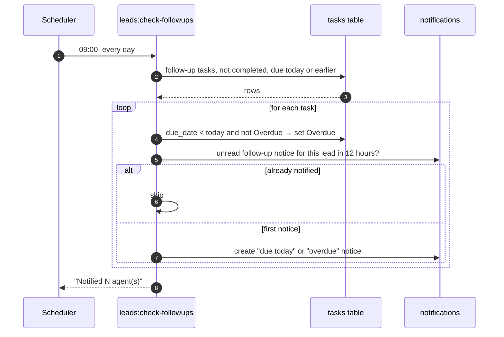
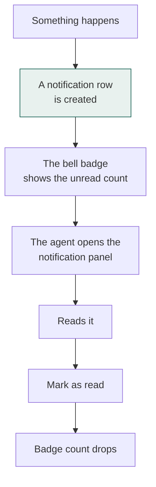
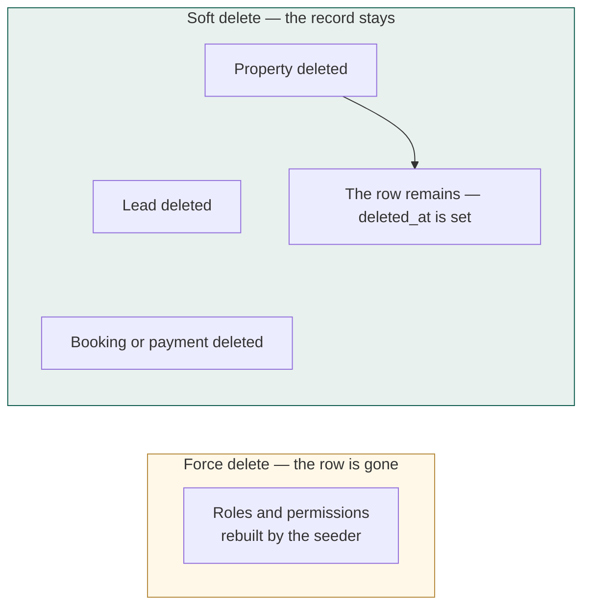

# 6. Operations and Automation

*What the system does on its own, what it does on a schedule, and what it does not do at all.*

---

## 6.1 The daily clock

Most of QREX is reactive: it happens because a person did something. A smaller part runs on a schedule, and a smaller part still happens because of the shape of the data.

```mermaid caption="Three kinds of automation — event-driven, scheduled and data-driven."
flowchart TB
  subgraph E["Event-driven — a person did something"]
    E1["Form submitted<br/>→ lead created"]
    E2["Status changed<br/>→ site visit created"]
    E3["Lead converted<br/>→ deal created"]
    E4["Follow-up set<br/>→ task created"]
    E5["Date cleared<br/>→ task completed"]
  end

  subgraph S["Scheduled — the clock says so"]
    S1["09:00 every day<br/>follow-up sweep"]
  end

  subgraph D["Data-driven — shape, not action"]
    D1["Delete cascades<br/>to related records"]
    D2["Soft deletes<br/>keep history"]
  end

  E ~~~ S
  S ~~~ D

  style E fill:#e8f1ee,stroke:#0f5c4e
  style S fill:#fff8e8,stroke:#b5893b
  style D fill:#eef1f5,stroke:#c9d2dd
```

---

## 6.2 Every automatic behaviour in the system

| Trigger | What happens automatically | What it does **not** do |
| --- | --- | --- |
| Public enquiry submitted | Creates a lead (`source = Website`, `status = New`, `score = 0`), logs a *Note* activity, links the property if the enquiry came from a listing | It does not assign an agent, and it does not create a follow-up task |
| Lead status → *Site Visit Scheduled* | Creates a site visit once, dated from the next-follow-up date (defaulting to tomorrow at 10:00), names the property, notifies the agent | It does not create the task — only the site visit |
| Next-follow-up date set on a lead or activity | Saves the date, creates or updates the `TSK-###` follow-up task at priority *High*, stamps the lead's last contact | It does not create a calendar event or send an email |
| Next-follow-up date cleared | Marks the open follow-up task *Completed* rather than deleting it | It does not delete the task, and does not touch other tasks |
| Lead converted to a deal | Creates deal `DL-###` at *Qualified* / probability 30, sets the lead to *Converted*, logs a *Conversion* activity, notifies the agent | It does not create a booking, an agreement or an invoice |
| A booking or a payment is saved | Recalculates the booking's payment totals and its derived status | It does not move money and does not contact a bank |
| A property is deleted | The gallery and the related interest records follow it down | It does not delete the leads or the deals that referenced it |
| A lead is deleted | The lead, its activities, visits and tasks are removed together | It does not delete the deal it produced |

---

## 6.3 The 09:00 follow-up sweep

One scheduled command runs in the whole system, and it runs once a day.



Four rules keep the sweep from becoming noise:

| Rule | Why it exists |
| --- | --- |
| Only tasks of type **Follow-up** are considered | Other task types are managed by hand |
| **Completed** tasks are skipped | A finished follow-up is never re-flagged |
| A task already marked **Overdue** keeps its status | It does not get re-updated every morning |
| One unread notification per lead per 12 hours | An agent gets one reminder, not one per task, per day |

The 12-hour window is the quiet detail that matters. Without it, an agent with three overdue follow-ups on the same lead would receive three identical notifications every single morning.

---

## 6.4 The notifications system



| Notification type | Raised when | Goes to |
| --- | --- | --- |
| `lead_assigned` | A lead is assigned or reassigned | The new agent |
| `lead_converted` | A lead becomes a deal | The agent who converted it |
| `site_visit` | A site visit is created or scheduled | The assigned agent |
| `payment` | A payment is recorded or becomes overdue | The accountant |
| `booking` | A booking needs approval | The accountant |
| `task` | A task is assigned or becomes due | The assignee |
| `followup` | The 09:00 sweep finds a follow-up due or overdue | The assigned agent |

Notifications are rows in the database, not email. They live in the bell in the top bar, survive a page reload, and can be marked read or unread. **QREX does not send email about them** — except for the password reset.

---

## 6.5 The settings that change behaviour

Settings live in a key/value table and are read at request time, merged over the controller's defaults. That means a change takes effect on the next page load, with no deploy.

| Setting group | Key | Effect |
| --- | --- | --- |
| `general` | `project_name` | The name shown in the top bar, the browser tab and the public site |
| `general` | `agency_name` | The agency name shown publicly |
| `general` | `tagline` | The strapline on the public site and in the email footer |
| `general` | `contact_email`, `contact_phone`, `address` | The agency's contact block |
| `general` | `currency` | The symbol used everywhere money is displayed |
| `general` | `timezone` | The timezone dates are computed in |
| `branding` | `logo_url` | The logo in the sidebar and on the public site |
| `smtp_*` | `smtp_enabled`, `smtp_host`, `smtp_port`, `smtp_username`, `smtp_password`, `smtp_encryption`, `smtp_from_address`, `smtp_from_name` | Outgoing SMTP, configured from the Settings page instead of the environment file |
| `smtp_*` | `smtp_test_email` | Sends a test message to prove the settings work |
| Feature | `enable_contact_form` | Whether the public enquiry form accepts submissions |
| Feature | `maintenance_mode` | Puts the public site into maintenance |
| Feature | `lead_auto_assign` | Whether new website enquiries are auto-assigned to the default agent |
| Feature | `visit_reminders` | Whether site-visit reminders are sent |
| Feature | `payment_alerts` | Whether payment-overdue alerts are raised |

The SMTP settings are deliberately editable from the interface: an administrator can fix a broken mail configuration without a developer and without touching the server.

---

## 6.6 Data retention and deletion



| Rule | Effect |
| --- | --- |
| Business records are **soft-deleted** | A deleted lead still appears in historical reports, with its timeline intact |
| Deleting a lead removes its activities, visits and tasks | The orphan trail is not left behind |
| Deleting a property leaves leads and deals alone | A sale that already happened is not undone by tidying the inventory |
| Roles and permissions are force-deleted and rebuilt by the seeder | Deploying re-creates them from the canonical list |
| The `properties:sync-amenity-permissions` command is the safe upgrade path | It adds only the `amenities.*` permissions and attaches them to the roles that already manage properties — it never touches the rest |

That last row is worth understanding. On a fresh database the seeder is destructive by design — it deletes every role and permission and rebuilds them. On an established installation that would wipe hand-made roles, so the amenities permissions are added by a separate idempotent command instead.

---

## 6.7 What QREX deliberately does not do

Being explicit about the edges is more useful than a feature list.

| Not built | Why, and what happens instead |
| --- | --- |
| **Payment collection** | There is no gateway, no card form and no auto-debit. A payment is a *record* that money moved. Somebody else collects it. |
| **Email campaigns** | Campaigns are tracked — budget, spend, leads, conversions, ROI — but sending is done in a separate marketing tool and the results are brought back in. |
| **Commission calculation** | A closed-won deal produces revenue. It does not produce a commission figure. |
| **Document generation** | No invoices, no contracts, no PDFs of a booking. The booking record is the commitment. |
| **Automatic lead assignment by territory or round-robin** | `lead_auto_assign` is a single default agent, not a routing rule. Assignment is a human decision unless a default is configured. |
| **Background queues for the notifications** | Notifications are written inline, in the request. Simple, immediate, and visible without a worker. |
| **Multi-tenant isolation** | One database, one agency. Branch field exists for reporting and row-level scoping, not for hard isolation. |
| **Mobile application** | The app is responsive web. There is no native client. |

---

## 6.8 Where the automation stops and the person starts

The single most useful sentence in this chapter:

> **QREX automates the record, never the relationship.**

It will remember that a call happened. It will not make the call. It will remind you that a follow-up is due. It will not do the follow-up. It will create a site visit when the status says a visit is happening. It will not turn up.

Every step in [the sales lifecycle](02-sales-lifecycle.md) that produces revenue still needs a person to move it forward, and the system's job is to make sure that person can see exactly which step is waiting.

---

**Back to:** [README — How QREX Works](README.md)
